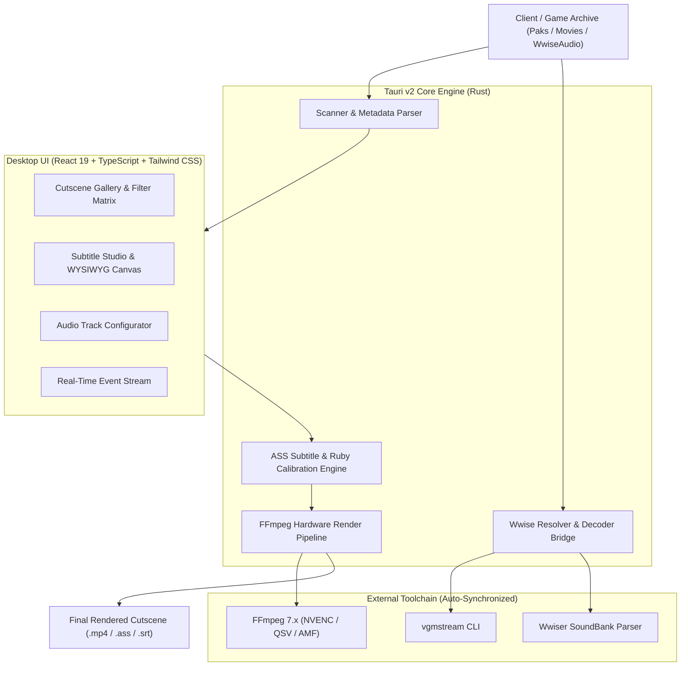

# WuWa Cutscene Studio

<div align="center">


<p align="center">
  <a href="https://github.com/Ma3-OS/wuwa-cutscene-studio/releases">
    
  </a>
  <a href="https://github.com/Ma3-OS/wuwa-cutscene-studio/actions/workflows/ci.yml">
    
  </a>
  <a href="LICENSE">
    
  </a>
  
  
  
  
</p>

<p align="center">
  <b>English</b> | <a href="README.th.md">ภาษาไทย</a>
</p>

**High-performance desktop suite for extracting, customizing, previewing, and rendering Wuthering Waves cinematic cutscenes with automated Wwise audio mixing, localized subtitle typography, and multi-resolution framing.**

[Features](#-key-features) • [Architecture](#-system-architecture) • [Audio Engine](#-wwise-audio-pipeline) • [Quick Start](#-quick-start) • [Development](#-developer-guide) • [Docs](docs/architecture.md) • [License](#-license--disclaimer)

</div>

---

## Overview

In **Wuthering Waves**, raw cinematic video files extracted from game archives do not contain embedded subtitles, localized character dialogue, or complete soundtrack mixes. Voiceovers and environmental audio reside inside proprietary Audiokinetic Wwise SoundBanks (`.bnk` / `.wem`), while dialogue scripts and Furigana / Ruby annotations are distributed across versioned game text databases.

**WuWa Cutscene Studio** automates this entire production pipeline in a native desktop environment:
- Discovers and catalogs cutscene videos across complex game directory structures.
- Parses Audiokinetic Wwise soundbanks and synchronizes multilingual voiceover tracks (Japanese, English, Korean, Simplified Chinese).
- Accurately aligns localized subtitle scripts and Ruby reading annotations with sub-pixel mathematical precision.
- Renders high-fidelity, hardware-accelerated videos (1080p, 21:9 UltraWide, 4K) via an optimized FFmpeg engine.

---

## Key Features

### 1. Smart Asset Discovery & Instant Preview
- **Zero-Extract Scanning:** Rapidly discovers cutscenes and maps corresponding audio banks without requiring upfront multi-gigabyte decompression.
- **Dynamic Metadata Extraction:** Real-time extraction of video duration, resolution, frame rate, and thumbnail badges.
- **Protagonist Routing:** Filters and routes dialogue tracks based on selected Rover gender (Female / Male).
- **Interactive Onboarding:** Intelligent detection for missing tool dependencies, unmapped export paths, or corrupted soundbanks.

### 2. Wwise Audio Pipeline & Multi-Track Mixing
- **SoundBank Decoding:** Integrates **Wwiser** and **vgmstream** to parse `.bnk` sound structures into `.txtp` configurations and decode 48kHz Opus audio streams.
- **Multilingual Voiceovers:** Seamless switching between Japanese (`ja`), English (`en`), Korean (`ko`), and Simplified Chinese (`zh-Hans`).
- **5.1-to-Stereo Matrix Downmixing:** Downmixes multi-channel game cinematics into balanced stereo with phase compensation and center dialogue boost.
- **Dynamic Peak Limiter:** Prevents digital clipping and audio distortion across complex multi-layer soundscapes.

### 3. Subtitle Studio & Typography Lab
- **Sub-Pixel Ruby Alignment:** Custom typographic engine calculating exact Ruby reading annotation placement over target characters with zero horizontal drift.
- **Libass Font Scaling Calibration:** Empirically calibrated font scale ratio ($0.635$) ensuring pixel-perfect parity between web preview canvas and FFmpeg `libass` output.
- **Corner Lyrics Display:** Independent top-left lyrics module with customizable font size, line spacing, margins, and border stroke.
- **Safe Area Guides:** Visual overlays for 90% Title Safe and Lower Third framing standards.
- **Presets & Granular Control:** Built-in typography presets, outline stroke control, shadow depth, and vertical margins.

### 4. Resolution & Aspect Ratio Engine
- **16:9 Zoom Fill (1920x1080):** Center-crops 21:9 ultrawide cinematics to fill standard 16:9 displays without letterbox black bars.
- **21:9 UltraWide (2560x1080):** Preserves native widescreen cinematics with cinematic top and bottom borders.
- **Native Resolution:** Retains original source dimensions without scaling.
- **4K UHD (3840x2160):** High-bitrate upscaling for archive-grade presentations.

### 5. Multi-Item Batch Queue & Task Automation
- **Multi-Item Queue:** Enqueue dozens of cutscenes with distinct gender, language, subtitle mode, and resolution settings.
- **Background Worker & Concurrency:** Multi-threaded encoding pipeline keeping the UI responsive at 120 FPS during heavy video rendering.
- **Automated Post-Render Power Actions:** Configure system actions upon queue completion (Chime alert, open output directory, system sleep, or automatic shutdown).

### 6. Zero-Lag Performance Architecture
- **Chromium Native Virtualization:** Utilizes `content-visibility: auto` to skip offscreen DOM layout, style, and paint calculations for 595+ cutscene cards.
- **Viewport Dwell Timer & LIFO Worker Queue:** 100ms dwell delay prevents thumbnail extraction stampedes during rapid scrolling; prioritizing active viewport cards first.
- **In-Memory Pre-Scanning:** Single-pass disk pre-indexing turns over 4,500 catalog filesystem queries into instant O(1) in-memory checks (<15ms catalog load).
- **Persistent DOM State:** Zero reflow and 0ms latency when switching between Studio, Subtitle Lab, Audio Engine, and Queue workspaces.

---

## Wwise Audio Pipeline

Why do certain cutscenes have voiceover and sound effects but no background music (BGM)?

```
┌──────────────────────────────────────────────────────────────────────────────────┐
│                           WUTHERING WAVES AUDIO ARCHITECTURE                     │
├──────────────────────────────────────────────────────────────────────────────────┤
│                                                                                  │
│   [Cinematic / Climax Cutscenes]                                                 │
│   └── Dedicated Movie SoundBank (.bnk)                                           │
│       ├── Voice Dialogue Track (.wem)  ──────┐                                   │
│       ├── Sound Effects SFX Track (.wem) ────┼──► [Extracted with Full Score]    │
│       └── Custom Music Score Track (.wem) ───┘                                   │
│                                                                                  │
│   [In-Engine Quest Cutscenes]                                                    │
│   ├── Cutscene Specific SoundBank (.bnk)                                         │
│   │   ├── Voice Dialogue Track (.wem)  ──────┐                                   │
│   │   └── Sound Effects SFX Track (.wem) ────┴──► [Extracted: Voice & SFX Only]   │
│   │                                                                              │
│   └── World Engine Ambient State (Interactive BGM System)                        │
│       └── Map / Battle Music Manager (Wwise State: Music_Event, State_...)       │
│           └── Generated dynamically at runtime during live gameplay              │
│                                                                                  │
└──────────────────────────────────────────────────────────────────────────────────┘
```

1. **Dedicated Movie SoundBanks:** Pre-rendered cinematic climaxes include a dedicated music track packaged directly inside the cutscene's `.bnk` file. In these cases, all audio layers are automatically decoded and mixed.
2. **In-Engine Quest Sequences:** Standard quest cutscenes rely on the game's dynamic open-world music system. Background music is triggered by global engine states rather than stored in the cutscene bank.
3. **Companion Music Linking:** The studio scans sequence event metadata to match and link companion music tracks whenever matching event mappings exist.

For technical details, see the [Audio Engine Documentation](docs/architecture.md#wwise-audio-pipeline).

---

## System Architecture



---

## Quick Start

### Installation

1. Download the latest release executable from the [Releases](https://github.com/Ma3-OS/wuwa-cutscene-studio/releases) page.
2. Run the installer (`WuWa-Cutscene-Studio-Setup.exe`) on Windows 10/11 64-bit.
3. Launch **WuWa Cutscene Studio**.

### Setup & Workflow

1. **System Synchronization:** Navigate to **Preferences** and click **Sync All Tools & Data** to automatically verify and download required binaries (FFmpeg, vgmstream, Wwiser) and text databases.
2. **Set Game Export Directory:** Point the export directory to your extracted game folder containing `Client/Content/Aki/`.
3. **Customize Subtitles:** Adjust font family, font size, stroke thickness, and Ruby annotations in the **Subtitle Studio**.
4. **Select & Render:** In the **Gallery**, select a cutscene, choose your voiceover language and protagonist gender, configure aspect ratio, and click **Start Processing**.

---

## Developer Guide

### Prerequisites
- **OS:** Windows 10 / 11 64-bit
- **Node.js:** v20.0.0 or higher with `npm`
- **Rust:** Stable toolchain (`x86_64-pc-windows-msvc`)
- **Python:** 3.10+ (for Wwiser SoundBank utilities)

### Building from Source

```powershell
# 1. Clone repository
git clone https://github.com/Ma3-OS/wuwa-cutscene-studio.git
cd wuwa-cutscene-studio

# 2. Install frontend dependencies
npm install

# 3. Run development server (Vite + Tauri)
npm run tauri dev

# 4. Build production installer
npm run tauri build
```

### Running Tests & Quality Checks

```powershell
# Check Rust backend
cargo check --manifest-path src-tauri/Cargo.toml

# Run subtitle & ruby alignment unit tests
cargo test --manifest-path src-tauri/Cargo.toml subtitles

# Validate TypeScript & build frontend bundle
npm run build

# Run repository sanitization audit
python scripts/pre_publish_audit.py
```

---

## Tech Stack

- **Desktop Framework:** [Tauri v2](https://v2.tauri.app/) (Rust backend)
- **Frontend:** [React 19](https://react.dev/), [TypeScript](https://www.typescriptlang.org/), [Tailwind CSS v4](https://tailwindcss.com/)
- **State Management & UI:** [Lucide Icons](https://lucide.dev/), [Framer Motion](https://www.framer.com/motion/)
- **Media Processing:** [FFmpeg 7.x](https://ffmpeg.org/), [vgmstream](https://github.com/vgmstream/vgmstream), [Wwiser](https://github.com/bnnm/wwiser)
- **Subtitle Engine:** [libass](https://github.com/libass/libass) with Advanced SubStation Alpha format

---

## Documentation

Detailed technical documentation is available in the [`docs/`](docs/) directory:
- [Architecture & Processing Pipeline](docs/architecture.md)
- [Subtitle Specifications & Ruby Typography](docs/subtitle-specs.md)

---

## Community & Contributing

Contributions are welcome! Please review our guidelines before submitting a pull request:
- [Contributing Guidelines](CONTRIBUTING.md)
- [Code of Conduct](CODE_OF_CONDUCT.md)
- [Security Policy](SECURITY.md)
- [Changelog](CHANGELOG.md)
- [Acknowledgements & Credits](CREDITS.md)

---

## Acknowledgements & Credits

**WuWa Cutscene Studio** is built upon the invaluable contributions of the open-source software community, game research pioneers, and reverse-engineering projects:

- **[Kuro Games](https://wutheringwaves.kurogames.com/)**: Creator and copyright holder of *Wuthering Waves*. All character designs, cinematic sequences, audio assets, script text, and trademarks are the sole intellectual property of Kuro Games.
- **[Hiro420](https://github.com/Hiro420)**: Author of [WuwaTools](https://github.com/Hiro420/WuwaTools) for foundational SQLite `ConfigDB` schema analysis and Base64-encoded `BinData` extraction logic enabling local offline textmap parsing.
- **[Arikatsu](https://github.com/Arikatsu)**: Maintainer of [WutheringWaves_Data](https://github.com/Arikatsu/WutheringWaves_Data) for establishing the standardized directory organization for `BinData` (`cgVedio`, `MusicSubTitle`) and multilingual textmaps.
- **[Fabian & CUE4Parse Contributors](https://github.com/FabianFG/CUE4Parse)**: High-performance C# package parsing library for Unreal Engine VFS and PAK containers powering native offline extraction.
- **[bnnm & Wwiser Contributors](https://github.com/bnnm/wwiser)**: Wwiser SoundBank graph parser and audio stream `.txtp` generation bridge.
- **[vgmstream Development Team](https://github.com/vgmstream/vgmstream)**: Lossless Audiokinetic `.wem` stream decoding into uncompressed 48kHz audio.
- **[FFmpeg Team](https://ffmpeg.org/)**: Industry-standard multimedia framework powering hardware-accelerated video rendering, 5.1-to-stereo audio downmixing, and subtitle burning.
- **[libass Project](https://github.com/libass/libass)**: Portable subtitle renderer for Advanced SubStation Alpha format with sub-pixel typography and Ruby placement accuracy.
- **[FModel Community](https://fmodel.app/)**: Exploration tools and reverse-engineering workflows for Unreal Engine game packages.
- **[Tauri Core Team](https://v2.tauri.app/)** & **[The Rust Project](https://www.rust-lang.org/)**: Lightweight, secure, and memory-efficient native desktop application framework.

For the comprehensive acknowledgements list and individual upstream details, please review [CREDITS.md](CREDITS.md).

---

## License & Disclaimer

This project is licensed under the **[MIT License](LICENSE)**.

> **Disclaimer:** *Wuthering Waves* and all associated visual assets, cutscene cinematics, dialogue texts, audio recordings, and trademarks are the intellectual property and copyright of **Kuro Games**.
> This software is an independent, non-commercial open-source tool developed strictly for personal study, backup archiving, and educational research.

