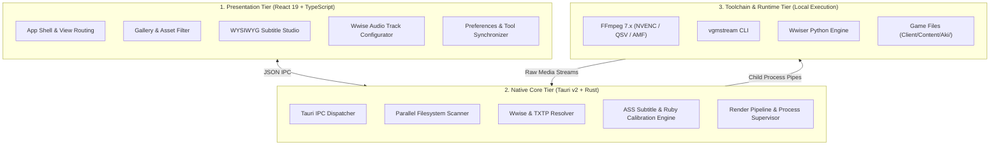
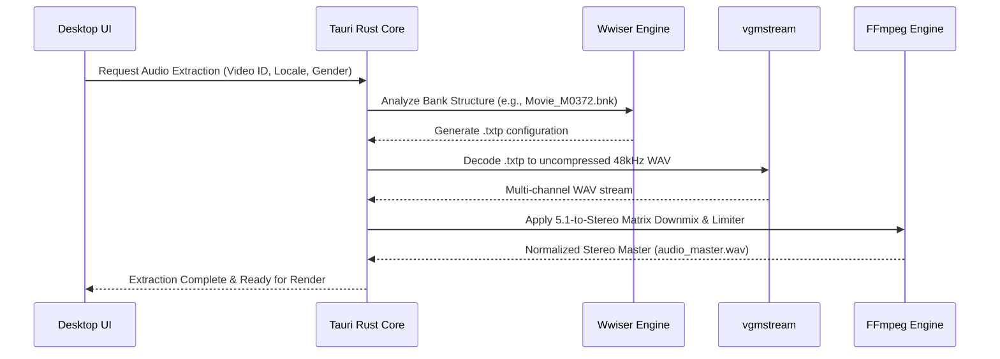

# System Architecture & Technical Specifications

This document outlines the internal architecture, data pipeline, and audio-video processing mechanisms in **WuWa Cutscene Studio**.

---

## 1. High-Level Architecture

WuWa Cutscene Studio is built upon a high-performance **3-tier desktop architecture**:



### Presentation Tier (Frontend)
- **Framework:** React 19 running on Vite 7 with strict TypeScript 5.8 typing.
- **Styling:** Tailwind CSS v4 utilizing a Monochrome Neutral Dark palette with high-contrast accessibility tokens.
- **Micro-Interactions:** Hardware-accelerated transitions via Framer Motion.

### Native Core Tier (Desktop Engine)
- **Host Framework:** Tauri v2 providing a lightweight WebKit / WebView2 container backed by native Rust.
- **Concurrency:** Multi-threaded asynchronous tasks managed by `tokio` and data-parallel file discovery via `rayon`.
- **Inter-Process Communication:** Strongly typed IPC commands serializing structured JSON payloads.

### Toolchain & Runtime Tier (External Utilities)
- **FFmpeg 7.x:** Hardware-accelerated video decoding, audio channel folding, and `libass` subtitle burning.
- **vgmstream:** Low-level decoding of proprietary Audiokinetic Wwise `.wem` audio packets into 48kHz PCM WAV.
- **Wwiser:** Graph analyzer resolving `.bnk` sound structures into `.txtp` playback trees.

---

## 2. Zero-Extract Asset Discovery

Traditional modding tools decompress multi-gigabyte Unreal Engine `.pak` files onto disk before playback, consuming massive temporary storage. WuWa Cutscene Studio employs a **Zero-Extract Scanning Strategy**:

```
[Game Client Directory]
  └── Client/Content/Aki/
        ├── Movies/
        │     └── *.mp4              --> Indexed in-place via zero-copy scanner
        └── WwiseAudio/
              ├── Windows/           --> Audio soundbanks (.bnk)
              └── *.pck / *.wem      --> Embedded stream containers
```

1. **Parallel Indexing:** The scanner walks `Client/Content/Aki/Movies/` recursively using Rust's `walkdir` and `rayon`, mapping movie identifiers (e.g., `M0372`, `Sequence_...`) in memory within milliseconds.
2. **Dynamic Header Parsing:** Video dimensions, frame rates, and durations are probed in parallel without decoding full streams.
3. **SoundBank Mapping:** Video IDs are matched against corresponding soundbanks in `Client/Content/Aki/WwiseAudio/Windows/` using pattern-matching rules and textmap event tables.

---

## 3. Wwise Audio Extraction & Mixing Pipeline

### The Audiokinetic Wwise Challenge
In Wuthering Waves, raw cutscene MP4 files are muted video streams. Audio assets are stored in proprietary `.bnk` (SoundBank) files that reference `.wem` (Wwise Encoded Media) files. These files often contain multi-track Opus or Vorbis streams.

### The Extraction Workflow



### 5.1-to-Stereo Channel Folding Formula
Cinematic soundbanks frequently deliver 5.1 surround sound (Left, Right, Center, LFE Subwoofer, Surround Left, Surround Right). Simply combining channels causes severe phase cancellation and muddled dialogue.

WuWa Cutscene Studio applies an ITU-R calibrated downmix matrix with center dialogue priority:

$$L_{\text{out}} = 0.500 \cdot L + 0.354 \cdot C + 0.354 \cdot \text{LFE} + 0.500 \cdot L_s$$

$$R_{\text{out}} = 0.500 \cdot R + 0.354 \cdot C + 0.354 \cdot \text{LFE} + 0.500 \cdot R_s$$

In addition, an audio peak limiter (`alimiter=limit=0.98`) prevents digital clipping when explosive sound effects and dialogue peaks coincide.

---

## 4. Video Rendering & Hardware Acceleration

The video rendering pipeline utilizes FFmpeg with automatic hardware acceleration detection:

```
                  ┌─ NVIDIA GPU: h264_nvenc (CBR/VBR high-performance)
                  ├─ Intel GPU:  h264_qsv   (Quick Sync Video)
GPU Capabilities ─┼─ AMD GPU:    h264_amf   (Advanced Media Framework)
                  └─ CPU:        libx264    (High-quality software fallback)
```

### Aspect Ratio Framing Engine
The application provides 4 framing modes:
- **16:9 Standard Zoom Fill (1920x1080):** Ultrawide 21:9 sources are cropped from the center:
  ```
  crop=in_h*16/9:in_h:(in_w-in_h*16/9)/2:0,scale=1920:1080:flags=lanczos
  ```
- **21:9 UltraWide Letterbox (2560x1080):** Preserves full widescreen field of view with cinematic black borders:
  ```
  scale=2560:1080:force_original_aspect_ratio=decrease,pad=2560:1080:(ow-iw)/2:(oh-ih)/2:black
  ```
- **Native Resolution:** Retains exact video dimensions without scaling.
- **4K UHD Upscaling (3840x2160):** Scaled using high-quality Lanczos resampling.

---

## 5. Security & Isolation

- **Zero Asset Bundling:** The repository contains no copyrighted game binaries, media clips, or encryption keys.
- **Deterministic Compilation:** The CUE4Parse Worker component compiles deterministically with `/src` path mapping to prevent local path leaks.
- **Sandboxed Subprocess Execution:** External binaries (`ffmpeg.exe`, `vgmstream-cli.exe`) are executed with explicit argument vectors, avoiding shell injection risks.

---

## 6. Upstream Dependencies & Credits

WuWa Cutscene Studio builds upon reverse-engineering research and multimedia engines developed by the open-source community. See [`CREDITS.md`](../CREDITS.md) for full attribution including Hiro420, Arikatsu, Fabian (CUE4Parse), bnnm (Wwiser), vgmstream, FFmpeg, and libass.

